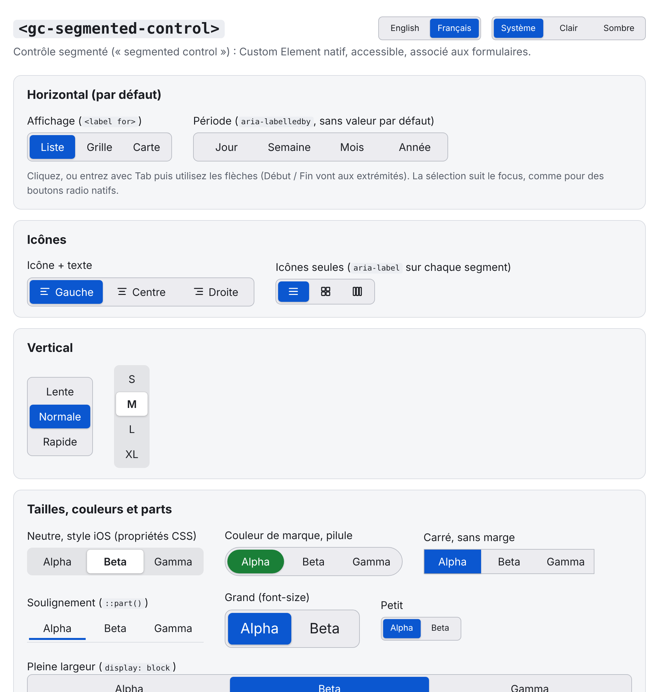

# `<gc-segmented-control>`

[English](README.md) · **Français**

Un contrôle segmenté réutilisable : un Custom Element natif (le préfixe `gc-` évite les conflits de noms avec d'autres bibliothèques), sans framework ni dépendance, accessible et associé aux formulaires. Il fait partie de la famille [gc-components](https://github.com/slone/gc-components), avec [`<gc-toggle-switch>`](../gc-toggle-switch/), et en suit les conventions.



**Démo en ligne :** <https://slone.github.io/gc-components/gc-segmented-control/?lang=fr> (source : [`demo.html`](demo.html), en français et en anglais).

## Le nom de ce contrôle

En UX, ce contrôle s'appelle **segmented control** (`UISegmentedControl` chez Apple), ou **segmented button** (Material Design 3), ou encore **groupe de boutons** / **toggle button group**. Il présente côte à côte un petit nombre d'options mutuellement exclusives, et le choix s'applique en général immédiatement (changer de vue, de période, d'alignement).

Sémantiquement, c'est un **groupe de boutons radio** : une seule option au plus est sélectionnée. Il est exposé comme tel (`role="radiogroup"` avec des enfants `role="radio"`), et les lecteurs d'écran annoncent « Liste, bouton radio, sélectionné, 1 sur 3 ».

Ce n'est pas une **liste d'onglets** : les onglets affichent et masquent des panneaux de contenu. Pour cela, utilisez `role="tablist"`.

## Installation

Avec npm et un bundler :

```sh
npm install gc-segmented-control
```

```js
import 'gc-segmented-control';
```

Depuis le CDN jsDelivr (fixez une version en production) :

```html
<script type="module" src="https://cdn.jsdelivr.net/npm/gc-segmented-control@0.1.0/gc-segmented-control.js"></script>
```

Sans npm, rien à compiler. Copiez `gc-segmented-control.js` du paquet npm (ou de jsDelivr) dans votre projet et importez-le comme module ES :

```html
<script type="module" src="./gc-segmented-control.js"></script>
```

ou, depuis un autre module :

```js
import { SegmentedControl, Segment } from './gc-segmented-control.js';
```

Le module définit deux éléments, `<gc-segmented-control>` et `<gc-segment>`, une seule fois même si le fichier est importé plusieurs fois.

> Les modules ES ne se chargent pas depuis `file://`. Servez la page en HTTP, par exemple avec `python -m http.server` dans ce dossier, puis ouvrez `http://localhost:8000/demo.html`.

## Usage

```html
<label for="vue">Affichage</label>
<gc-segmented-control id="vue" name="vue" value="liste">
  <gc-segment value="liste">Liste</gc-segment>
  <gc-segment value="grille">Grille</gc-segment>
  <gc-segment value="carte">Carte</gc-segment>
</gc-segmented-control>

<!-- Icônes seules : donnez un nom accessible à chaque segment. -->
<gc-segmented-control aria-label="Alignement" value="gauche">
  <gc-segment value="gauche" aria-label="Gauche"><svg aria-hidden="true">…</svg></gc-segment>
  <gc-segment value="droite" aria-label="Droite"><svg aria-hidden="true">…</svg></gc-segment>
</gc-segmented-control>

<!-- Vertical, présélection par l'attribut "selected" d'un segment. -->
<gc-segmented-control orientation="vertical" aria-label="Vitesse">
  <gc-segment>Lente</gc-segment>
  <gc-segment selected>Normale</gc-segment>
  <gc-segment>Rapide</gc-segment>
</gc-segmented-control>
```

```js
const vue = document.querySelector('#vue');
vue.addEventListener('change', () => console.log(vue.value));
vue.value = 'grille';   // n'émet aucun événement
```

Le contrôle est aussi large que son contenu, et **tous les segments prennent la largeur du plus large**. Pour qu'il remplisse son conteneur : `display: block` (ou `width: 100%`).

Un indicateur de sélection glisse d'un segment à l'autre.

## Attributs de `<gc-segmented-control>`

| Attribut | Rôle |
|---|---|
| `value` | Valeur du segment sélectionné. L'attribut présent dans le HTML (ou posé par `setAttribute`) fixe aussi la **valeur par défaut** utilisée par `form.reset()`. Il n'est pas reflété : la propriété `value` donne la valeur courante. |
| `name` | Nom du champ dans le formulaire. |
| `disabled` | Désactive tout le contrôle : aucun segment ne peut être sélectionné ni recevoir le focus, et rien n'est envoyé. Un `<fieldset disabled>` parent a le même effet. |
| `required` | Le formulaire est invalide tant qu'aucun segment n'est sélectionné. Le message est en français si la page (ou un parent) a `lang="fr…"`, en anglais sinon. `setCustomValidity()` permet de le remplacer. |
| `orientation` | `horizontal` (par défaut) ou `vertical`. |
| `dir` | Hérité de la page ou d'un parent. Avec `dir="rtl"`, les segments vont de droite à gauche. |
| `aria-label`, `aria-labelledby`, `aria-describedby` | Nom accessible du groupe en l'absence de `<label>`. |

## Attributs de `<gc-segment>`

| Attribut | Rôle |
|---|---|
| `value` | Valeur envoyée quand ce segment est sélectionné. Sans lui, le **texte** du segment est utilisé, comme pour `<option>`. |
| `selected` | Le segment sélectionné. Il est reflété et tenu à jour par le contrôle : sélectionner un segment retire l'attribut des autres. Dans le HTML, il présélectionne un segment quand le contrôle n'a pas d'attribut `value`. |
| `disabled` | Ce segment ne peut pas être sélectionné, et les flèches le sautent. |
| `aria-label` | Nom accessible, indispensable pour un segment qui ne contient qu'une icône. |

Les segments doivent être des **enfants directs** du contrôle. Les autres enfants sont affichés mais ignorés.

## Propriétés et méthodes JavaScript

`SegmentedControl` (`<gc-segmented-control>`) :

| Membre | Description |
|---|---|
| `value` | `string`, valeur du segment sélectionné, ou `""` s'il n'y en a pas. L'affecter sélectionne le segment correspondant (ou aucun). Si aucun segment ne correspond encore, la valeur est gardée et appliquée dès qu'un segment correspondant est ajouté. |
| `defaultValue` | `string`, la valeur restaurée par `form.reset()`. |
| `selectedIndex` | `number`, index du segment sélectionné, ou `-1`. |
| `segments` | `Segment[]`, les enfants `<gc-segment>`, dans l'ordre. |
| `selectedSegment` | `Segment \| null`. |
| `disabled`, `required`, `name`, `orientation` | Reflètent les attributs du même nom. |
| `form`, `labels`, `validity`, `validationMessage`, `willValidate` | Comme pour un champ natif. |
| `checkValidity()`, `reportValidity()`, `setCustomValidity(msg)` | Validation, comme pour un champ natif. |
| `focus()` | Donne le focus au segment sélectionné (ou au premier actif). |
| `SegmentedControl.registerMessages(lang, { valueMissing })` | Statique. Ajoute ou remplace le message de `required` pour une langue. |

`Segment` (`<gc-segment>`) : `value`, `selected`, `disabled` (reflètent les attributs), et `control` (le `<gc-segmented-control>` parent, ou `null`).

Comme pour les champs natifs, un changement fait par script (`value = …`, `selected = true`) **n'émet aucun événement**.

## Événements

| Événement | Quand |
|---|---|
| `input` | À chaque fois que l'utilisateur sélectionne un autre segment (souris, toucher, clavier). Il remonte et traverse les shadow roots (`composed`). |
| `change` | Juste après `input`. Il remonte. |

Sélectionner le segment déjà sélectionné n'émet rien.

## Propriétés CSS personnalisées

À poser sur le contrôle ou sur n'importe quel ancêtre.

| Propriété | Défaut | Rôle |
|---|---|---|
| `--segmented-background` | `#ececf0` (clair) / `#2b2e35` (sombre) | Fond du rail |
| `--segmented-border` | `1px solid #b9bcc4` / `#4a4f5a` | Bordure du rail (raccourci, `none` pour l'enlever) |
| `--segmented-color` | héritée | Couleur du texte des segments |
| `--segmented-selected-color` | `#ffffff` / `#062e6f` | Couleur du texte du segment sélectionné |
| `--segmented-indicator-color` | `#0b57d0` / `#a8c7fa` | Indicateur de sélection |
| `--segmented-indicator-shadow` | ombre légère | Ombre de l'indicateur (`none` pour l'enlever) |
| `--segmented-hover-color` | gris translucide | Fond d'un segment survolé |
| `--segmented-radius` | `0.5em` | Rayon des coins extérieurs. Les coins intérieurs en sont déduits. |
| `--segmented-padding` | `0.1875em` | Espace entre le bord du rail et les segments |
| `--segmented-gap` | `0.125em` | Espace entre deux segments |
| `--segmented-segment-padding` | `0.375em 0.875em` | Marge intérieure de chaque segment |
| `--segmented-focus-color` | `#0b57d0` / `#a8c7fa` | Anneau de focus |
| `--segmented-duration` | `200ms` | Durée des animations |

Les tailles sont en `em` : le contrôle suit sa taille de police. Pour garder la couleur de texte de la page sur le segment sélectionné, utilisez `currentColor` (et non `inherit`, que les propriétés personnalisées ne transmettent pas) :

```css
/* Style iOS : indicateur neutre, texte sélectionné en gras. */
gc-segmented-control.neutre {
  --segmented-indicator-color: light-dark(#ffffff, #636366);
  --segmented-selected-color: currentColor;
  --segmented-border: none;
  --segmented-background: light-dark(rgb(118 118 128 / .14), rgb(118 118 128 / .3));
}
gc-segmented-control.neutre gc-segment[selected] { font-weight: 600; }
```

Les segments sont dans le light DOM : stylez-les directement (`gc-segment`, `gc-segment[selected]`, `gc-segment:state(selected)`).

## Parts (`::part()`)

| Part | Élément |
|---|---|
| `track` | Le conteneur (fond, bordure, grille des segments). |
| `indicator` | L'indicateur de sélection qui glisse. |

```css
/* Soulignement façon onglets. */
.souligne::part(track) { background: none; border: none; border-bottom: 1px solid #ccc; border-radius: 0; }
.souligne::part(indicator) { background: none; box-shadow: inset 0 -3px 0 #0b57d0; border-radius: 0; }

/* Segments à la largeur de leur contenu plutôt qu'égaux. */
.naturel::part(track) { grid-auto-columns: auto; }
```

## Avant le chargement du script

Tant que le module n'est pas chargé, le navigateur ne connaît pas les éléments et affiche les segments comme du texte brut. Pour obtenir une mise en page proche dès le premier affichage, copiez ces règles dans la feuille de style de la page :

```css
gc-segmented-control:not(:defined) {
  display: inline-flex;
  gap: 0.125em;
  padding: 0.1875em;
  border: 1px solid #b9bcc4;
  border-radius: 0.5em;
  vertical-align: middle;
  opacity: 0.5;
}
gc-segmented-control[orientation="vertical" i]:not(:defined) { flex-direction: column; }
gc-segment:not(:defined) { display: block; padding: 0.375em 0.875em; text-align: center; white-space: nowrap; }
```

## Accessibilité

- **Rôles et états** : `role="radiogroup"` sur le contrôle, `role="radio"` et `aria-checked` sur chaque segment, exposés via `ElementInternals` sans ajouter d'attributs ARIA au DOM. `aria-disabled`, `aria-required` et `aria-orientation` suivent l'état.
- **Nom** : `<label for="id">` (un clic sur le label place le focus dans le groupe), sinon `aria-label` / `aria-labelledby` sur le contrôle. Les segments ne contenant qu'une icône ont besoin d'un `aria-label`.
- **Clavier**, comme pour des boutons radio natifs ([motif « radio group » de l'APG ARIA](https://www.w3.org/WAI/ARIA/apg/patterns/radio/)) :
  - **Tab** entre dans le groupe sur le segment sélectionné (ou le premier) et en sort en une fois (`tabindex` itinérant) ;
  - les **flèches** passent au segment suivant / précédent **et le sélectionnent**, en bouclant et en sautant les segments désactivés. Les deux paires de flèches marchent dans les deux orientations ;
  - **Début / Fin** vont au premier / dernier segment ;
  - **Espace** sélectionne le segment qui a le focus quand aucun n'est sélectionné.
- **Focus visible** : un anneau autour du segment qui a le focus, à la navigation clavier seulement (`:focus-visible`).
- **Zone de clic** : chaque segment fait au moins 24 × 24 px (WCAG 2.5.8).
- **Droite à gauche** : la disposition suit `dir`, et les flèches Gauche / Droite suivent l'ordre visuel.
- **Mouvements réduits** : avec `prefers-reduced-motion: reduce`, l'indicateur saute au lieu de glisser.
- **Thèmes clair et sombre** : les couleurs par défaut utilisent `light-dark()` et suivent le `color-scheme` de la page (avec repli sur `prefers-color-scheme`). Le segment sélectionné est signalé par un indicateur plein (blanc sur `#0b57d0` : 6,4:1 ; `#062e6f` sur `#a8c7fa` : 7,5:1), qui se détache du rail à plus de 5:1 (WCAG 1.4.11).
- **Contraste élevé** (Windows, `forced-colors`) : l'indicateur utilise `Highlight` et le texte sélectionné `HighlightText`.

Si vous choisissez un indicateur discret (style iOS), ajoutez un autre repère de sélection, du texte en gras par exemple, pour ne pas dépendre d'une faible différence de contraste.

## Formulaires

Le contrôle est un *form-associated custom element* :

- il est envoyé avec le formulaire (`name=value` si un segment est sélectionné, rien sinon) ;
- `required` bloque l'envoi tant qu'aucun segment n'est sélectionné ;
- `form.reset()` restaure sa valeur par défaut (l'attribut `value` d'origine, le segment marqué `selected` à l'origine, ou `defaultValue`) ;
- `<fieldset disabled>` le désactive ;
- le navigateur restaure sa valeur lors d'un retour dans l'historique.

## TypeScript

`gc-segmented-control.d.ts` est placé à côté du module et pris en compte à l'import. `document.querySelector('gc-segmented-control')` est alors typé `SegmentedControl | null`.

## Navigateurs

Versions actuelles de Chrome/Edge, Firefox et Safari (2024 et après) : Custom Elements, Shadow DOM, `ElementInternals` avec réflexion ARIA, `adoptedStyleSheets`, `ResizeObserver`, `light-dark()`. L'effet de survol des segments utilise `:state()` ; sans lui, les segments n'ont simplement pas de fond au survol.

## Fichiers

- `gc-segmented-control.js` : le composant (les deux éléments). Le fichier publié est un module ES autonome (le code partagé `gc-base` y est intégré à la publication) : c'est le seul fichier à copier dans un projet, depuis npm ou jsDelivr.
- `demo.html` : démo de toutes les variantes, en français et en anglais (`?lang=fr` / `?lang=en`).
- `docs/preview.png` : capture utilisée dans les README.
- `test/` : tests Playwright (Chromium, Firefox, WebKit).
- `gc-segmented-control.d.ts`, `custom-elements.json`, `vscode.html-custom-data.json` : types et métadonnées pour les éditeurs (facultatif ; les deux derniers sont générés par `npm run analyze`).
- `index.html` : redirige vers la démo.
- `README.md` (anglais), `README.fr.md` (ce document), `CHANGELOG.md`.

## Développement

Pas d'étape de build. Depuis la racine du monorepo :

```sh
npm install
npx playwright test packages/gc-segmented-control
python -m http.server 8000   # puis ouvrez http://localhost:8000/packages/gc-segmented-control/demo.html
```

## Licence

[MIT](LICENSE) © 2026 Chantraine.net
