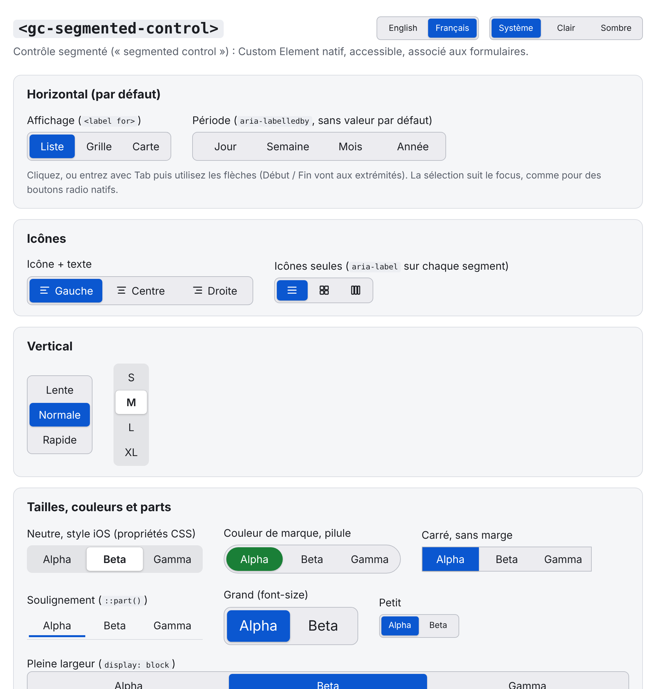

# `<gc-segmented-control>`

**English** · [Français](README.fr.md)

A reusable segmented control: a native Custom Element (the `gc-` prefix avoids name clashes with other libraries), with no framework or dependency, accessible and form-associated. It is part of the [gc-components](https://github.com/slone/gc-components) family, with [`<gc-toggle-switch>`](../gc-toggle-switch/), and follows the same conventions.



**Live demo:** <https://slone.github.io/gc-components/gc-segmented-control/> (source: [`demo.html`](demo.html), in English and French).

## What this control is called

In UX, this control is a **segmented control** (Apple's `UISegmentedControl`), also called **segmented button** (Material Design 3) or **button group** / **toggle button group**. It shows a small set of mutually exclusive options side by side, and the choice usually takes effect immediately (switching a view, a period, an alignment).

Semantically, it is a **group of radio buttons**: one option at most is selected. It is exposed as such (`role="radiogroup"` with `role="radio"` children), so screen readers announce "List, radio button, selected, 1 of 3".

It is not a **tab list**: tabs show and hide panels of content. For that, use `role="tablist"`.

## Installation

With npm and a bundler:

```sh
npm install gc-segmented-control
```

```js
import 'gc-segmented-control';
```

From the jsDelivr CDN (pin a version in production):

```html
<script type="module" src="https://cdn.jsdelivr.net/npm/gc-segmented-control@0.1.0/gc-segmented-control.js"></script>
```

Without npm, there is nothing to build. Copy `gc-segmented-control.js` from the npm package (or jsDelivr) into your project and import it as an ES module:

```html
<script type="module" src="./gc-segmented-control.js"></script>
```

or, from another module:

```js
import { SegmentedControl, Segment } from './gc-segmented-control.js';
```

The module defines two elements, `<gc-segmented-control>` and `<gc-segment>`, only once even if the file is imported several times.

> ES modules do not load from `file://`. Serve the page over HTTP, for example with `python -m http.server` in this folder, then open `http://localhost:8000/demo.html`.

## Usage

```html
<label for="view">View</label>
<gc-segmented-control id="view" name="view" value="list">
  <gc-segment value="list">List</gc-segment>
  <gc-segment value="grid">Grid</gc-segment>
  <gc-segment value="map">Map</gc-segment>
</gc-segmented-control>

<!-- Icons only: give each segment an accessible name. -->
<gc-segmented-control aria-label="Alignment" value="left">
  <gc-segment value="left" aria-label="Left"><svg aria-hidden="true">…</svg></gc-segment>
  <gc-segment value="right" aria-label="Right"><svg aria-hidden="true">…</svg></gc-segment>
</gc-segmented-control>

<!-- Vertical, preselected with the "selected" attribute of a segment. -->
<gc-segmented-control orientation="vertical" aria-label="Speed">
  <gc-segment>Slow</gc-segment>
  <gc-segment selected>Normal</gc-segment>
  <gc-segment>Fast</gc-segment>
</gc-segmented-control>
```

```js
const view = document.querySelector('#view');
view.addEventListener('change', () => console.log(view.value));
view.value = 'grid';   // fires no event
```

The control is as wide as its content, and **all segments share the width of the widest one**. Make it fill its container with `display: block` (or `width: 100%`).

A selection indicator slides from one segment to the other.

## `<gc-segmented-control>` attributes

| Attribute | Purpose |
|---|---|
| `value` | Value of the selected segment. The attribute present in the HTML (or set with `setAttribute`) also sets the **default value** used by `form.reset()`. It is not reflected: the `value` property holds the current value. |
| `name` | Field name in the form. |
| `disabled` | Disables the whole control: no segment can be selected or focused, and nothing is submitted. A parent `<fieldset disabled>` has the same effect. |
| `required` | The form is invalid while no segment is selected. The message is in French when the page (or a parent) has `lang="fr…"`, in English otherwise. Override it with `setCustomValidity()`. |
| `orientation` | `horizontal` (default) or `vertical`. |
| `dir` | Inherited from the page or a parent. With `dir="rtl"`, segments run from right to left. |
| `aria-label`, `aria-labelledby`, `aria-describedby` | Accessible name of the group when there is no `<label>`. |

## `<gc-segment>` attributes

| Attribute | Purpose |
|---|---|
| `value` | Value submitted when this segment is selected. Without it, the segment's **text content** is used, as with `<option>`. |
| `selected` | The selected segment. It is reflected and kept in sync by the control: selecting one segment removes the attribute from the others. In the HTML, it preselects a segment when the control has no `value` attribute. |
| `disabled` | This segment cannot be selected and is skipped by the arrow keys. |
| `aria-label` | Accessible name, needed for icon-only segments. |

Segments must be **direct children** of the control. Other children are displayed but ignored.

## JavaScript properties and methods

`SegmentedControl` (`<gc-segmented-control>`):

| Member | Description |
|---|---|
| `value` | `string`, value of the selected segment, or `""` when none is selected. Setting it selects the matching segment (or none). If no segment matches yet, the value is kept and applied when a matching segment is added. |
| `defaultValue` | `string`, the value restored by `form.reset()`. |
| `selectedIndex` | `number`, index of the selected segment, or `-1`. |
| `segments` | `Segment[]`, the `<gc-segment>` children, in order. |
| `selectedSegment` | `Segment \| null`. |
| `disabled`, `required`, `name`, `orientation` | Reflect the attributes of the same name. |
| `form`, `labels`, `validity`, `validationMessage`, `willValidate` | As for a native field. |
| `checkValidity()`, `reportValidity()`, `setCustomValidity(msg)` | Validation, as for a native field. |
| `focus()` | Focuses the selected segment (or the first enabled one). |
| `SegmentedControl.registerMessages(lang, { valueMissing })` | Static. Adds or overrides the `required` message for a language. |

`Segment` (`<gc-segment>`): `value`, `selected`, `disabled` (reflect the attributes), and `control` (the parent `<gc-segmented-control>`, or `null`).

As with native fields, a change made by script (`value = …`, `selected = true`) **fires no event**.

## Events

| Event | When |
|---|---|
| `input` | Each time the user selects another segment (mouse, touch, keyboard). It bubbles and crosses shadow roots (`composed`). |
| `change` | Right after `input`. It bubbles. |

Selecting the segment that is already selected fires nothing.

## CSS custom properties

Set them on the control or on any ancestor.

| Property | Default | Purpose |
|---|---|---|
| `--segmented-background` | `#ececf0` (light) / `#2b2e35` (dark) | Track background |
| `--segmented-border` | `1px solid #b9bcc4` / `#4a4f5a` | Track border (shorthand, `none` to remove it) |
| `--segmented-color` | inherited | Text colour of the segments |
| `--segmented-selected-color` | `#ffffff` / `#062e6f` | Text colour of the selected segment |
| `--segmented-indicator-color` | `#0b57d0` / `#a8c7fa` | Selection indicator |
| `--segmented-indicator-shadow` | subtle shadow | Indicator shadow (`none` to remove it) |
| `--segmented-hover-color` | translucent grey | Background of a hovered segment |
| `--segmented-radius` | `0.5em` | Outer corner radius. Inner corners are derived from it. |
| `--segmented-padding` | `0.1875em` | Gap between the track edge and the segments |
| `--segmented-gap` | `0.125em` | Gap between two segments |
| `--segmented-segment-padding` | `0.375em 0.875em` | Inner padding of each segment |
| `--segmented-focus-color` | `#0b57d0` / `#a8c7fa` | Focus ring |
| `--segmented-duration` | `200ms` | Animation duration |

Sizes are in `em`: the control follows its font size. To keep the page's text colour for the selected segment, use `currentColor` (not `inherit`, which custom properties do not pass through):

```css
/* iOS style: neutral indicator, bold selected text. */
gc-segmented-control.neutral {
  --segmented-indicator-color: light-dark(#ffffff, #636366);
  --segmented-selected-color: currentColor;
  --segmented-border: none;
  --segmented-background: light-dark(rgb(118 118 128 / .14), rgb(118 118 128 / .3));
}
gc-segmented-control.neutral gc-segment[selected] { font-weight: 600; }
```

Segments are in the light DOM: style them directly (`gc-segment`, `gc-segment[selected]`, `gc-segment:state(selected)`).

## Parts (`::part()`)

| Part | Element |
|---|---|
| `track` | The container (background, border, grid of segments). |
| `indicator` | The sliding selection indicator. |

```css
/* Tab-like underline. */
.underline::part(track) { background: none; border: none; border-bottom: 1px solid #ccc; border-radius: 0; }
.underline::part(indicator) { background: none; box-shadow: inset 0 -3px 0 #0b57d0; border-radius: 0; }

/* Segments sized to their content instead of equal widths. */
.natural::part(track) { grid-auto-columns: auto; }
```

## Before the script loads

Until the module is loaded, the browser does not know the elements and shows the segments as plain text. To get a close layout from the first paint, copy these rules into the page's stylesheet:

```css
gc-segmented-control:not(:defined) {
  display: inline-flex;
  gap: 0.125em;
  padding: 0.1875em;
  border: 1px solid #b9bcc4;
  border-radius: 0.5em;
  vertical-align: middle;
  opacity: 0.5;
}
gc-segmented-control[orientation="vertical" i]:not(:defined) { flex-direction: column; }
gc-segment:not(:defined) { display: block; padding: 0.375em 0.875em; text-align: center; white-space: nowrap; }
```

## Accessibility

- **Roles and states**: `role="radiogroup"` on the control, `role="radio"` and `aria-checked` on each segment, exposed through `ElementInternals` without adding ARIA attributes to the DOM. `aria-disabled`, `aria-required` and `aria-orientation` follow the state.
- **Name**: `<label for="id">` (clicking the label moves focus into the group), otherwise `aria-label` / `aria-labelledby` on the control. Icon-only segments need an `aria-label`.
- **Keyboard**, as for native radio buttons ([ARIA APG radio group pattern](https://www.w3.org/WAI/ARIA/apg/patterns/radio/)):
  - **Tab** enters the group on the selected segment (or the first one) and leaves it in one step (roving `tabindex`);
  - **arrow keys** move to the next / previous segment **and select it**, wrapping around and skipping disabled segments. Both arrow pairs work in both orientations;
  - **Home / End** go to the first / last segment;
  - **Space** selects the focused segment when none is selected.
- **Visible focus**: a ring around the focused segment, for keyboard navigation only (`:focus-visible`).
- **Hit area**: each segment is at least 24 × 24 px (WCAG 2.5.8).
- **Right-to-left**: the layout follows `dir`, and the Left / Right arrows follow the visual order.
- **Reduced motion**: with `prefers-reduced-motion: reduce`, the indicator jumps instead of sliding.
- **Light and dark themes**: default colours use `light-dark()` and follow the page's `color-scheme` (with a `prefers-color-scheme` fallback). The selected segment is shown by a solid indicator (white on `#0b57d0`: 6.4:1; `#062e6f` on `#a8c7fa`: 7.5:1), which stands out from the track by more than 5:1 (WCAG 1.4.11).
- **High contrast** (Windows, `forced-colors`): the indicator uses `Highlight` and the selected text `HighlightText`.

If you choose a subtle indicator (iOS style), add another cue for the selection, such as bold text, so that it does not rely on a small contrast difference.

## Forms

The control is a *form-associated custom element*:

- it is submitted with the form (`name=value` when a segment is selected, nothing otherwise);
- `required` blocks submission while no segment is selected;
- `form.reset()` restores its default value (the original `value` attribute, the segment originally marked `selected`, or `defaultValue`);
- `<fieldset disabled>` disables it;
- the browser restores its value when navigating back in history.

## TypeScript

`gc-segmented-control.d.ts` sits next to the module and is picked up when you import it. `document.querySelector('gc-segmented-control')` is then typed as `SegmentedControl | null`.

## Browser support

Current versions of Chrome/Edge, Firefox and Safari (2024 and later): Custom Elements, Shadow DOM, `ElementInternals` with ARIA reflection, `adoptedStyleSheets`, `ResizeObserver`, `light-dark()`. The hover effect of segments uses `:state()`; without it, segments simply have no hover background.

## Files

- `gc-segmented-control.js`: the component (both elements). The published file is a standalone ES module (the shared `gc-base` code is inlined at pack time): it is the only file to copy into a project, from npm or jsDelivr.
- `demo.html`: demo of every variant, in English and French (`?lang=en` / `?lang=fr`).
- `docs/preview.png`: screenshot used in the READMEs.
- `test/`: Playwright tests (Chromium, Firefox, WebKit).
- `gc-segmented-control.d.ts`, `custom-elements.json`, `vscode.html-custom-data.json`: types and editor metadata (optional; the last two are generated by `npm run analyze`).
- `index.html`: redirects to the demo.
- `README.md` (this document), `README.fr.md` (French), `CHANGELOG.md`.

## Development

No build step. From the root of the monorepo:

```sh
npm install
npx playwright test packages/gc-segmented-control
python -m http.server 8000   # then open http://localhost:8000/packages/gc-segmented-control/demo.html
```

## License

[MIT](LICENSE) © 2026 Chantraine.net
